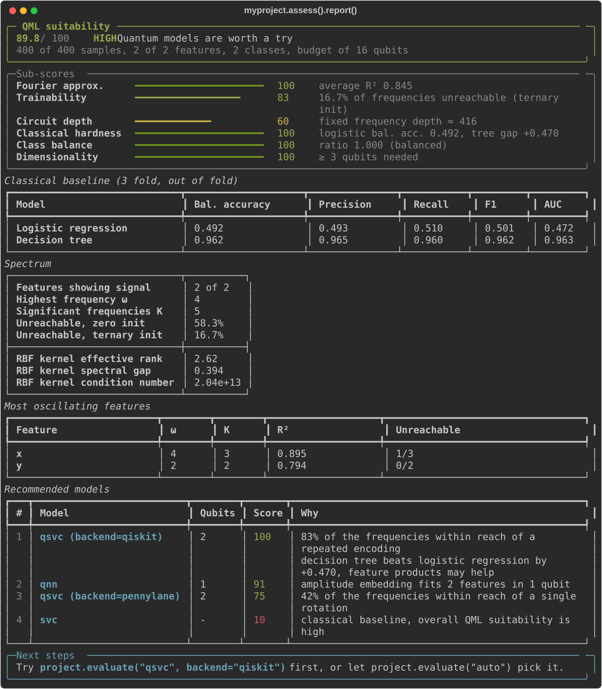

Before spending time (and qubits) on a quantum model it pays off to ask a simpler question: is there any chance it will do better than a classical one on *this* dataset? Quantum models are not a free upgrade. Some datasets are solved by a logistic regression in a few milliseconds, others have decision boundaries a quantum circuit simply cannot express with the resources at hand.

Falcondale's assessment looks at the data from the point of view of a quantum model and returns a suitability score, the reasons behind it and a ranking of the models available in Falcondale. It only needs a few seconds and runs entirely on classical resources.

```python
assessment = myproject.assess()
assessment.report()
```

<figure markdown>
  
  <figcaption>Assessment report of a dataset with circular classes</figcaption>
</figure>

## What a quantum model sees

Most quantum classifiers start by encoding each feature $x$ as the angle of a rotation. A circuit built that way computes a function that can be written as a truncated Fourier series of its inputs ([Schuld et al.](https://arxiv.org/abs/2008.08605)),

$$
f(x) = \sum_{\omega \in \Omega} c_\omega e^{i \omega x},
$$

where the set of frequencies $\Omega$ depends on how many times, and how, the data is encoded. A single rotation gives access to frequency 1, repeating the encoding or scaling the angles reaches higher frequencies. Hence, a good way of telling whether a circuit can follow our decision boundary is to look at the frequencies the boundary is made of.

Falcondale does this one feature at a time. Samples are sorted by the value of the feature and the labels, read in that order, form a signal. A boundary that switches class once along the feature produces a slow signal, one that switches back and forth produces a fast one. The discrete Fourier transform of that signal tells us which frequencies matter. Frequency index $k$ counts oscillations over the whole range of the feature, so $k = 1$ is what a single rotation can express when the feature is scaled to a full period.

Noise also oscillates. Overlapping classes and irrelevant features spread their power over all frequencies, so a frequency only counts as significant if it is stronger than anything the same labels produce once shuffled. Features where nothing stands out are reported as showing no signal: they do not constrain the circuit, they only take qubits.

For each feature we keep:

* $\omega_{max}$, the highest significant frequency
* $K$, the number of significant frequencies needed to carry 95% of the signal power
* $R^2$ of the signal rebuilt from those frequencies, how well a truncated Fourier series fits it
* how many of those frequencies are out of reach for a trainable encoding

That last point comes from the analysis by [Pöppel et al.](https://arxiv.org/abs/2602.23409) on the trainability of encodings: frequencies above 1 are not reachable starting from zero initialised encoding parameters, and those above 2 not even when initialising them on a ternary $\{-1, 0, 1\}$ grid.

## Scores

Six criteria are scored from 0 to 100 and combined into a single score:

| Criterion | Weight | What it measures |
|-----------|--------|------------------|
| Fourier approximability | 25% | Average $R^2$ of the per feature reconstructions |
| Trainability | 25% | Share of the significant frequencies reachable with a ternary initialisation |
| Circuit depth | 15% | Depth of a fixed frequency encoding, $O(\omega_{max}(\omega_{max} + \epsilon^{-2}))$ |
| Classical hardness | 20% | Balanced accuracy of a logistic regression (3 fold, out of fold), with a bonus when a decision tree does better |
| Class balance | 10% | Ratio between the smallest and the largest class |
| Dimensionality | 5% | Qubits needed to hold the significant frequencies against the qubit budget |

Classical hardness deserves a comment. If a linear model already solves the task there is little room left for a quantum kernel. If a shallow decision tree clearly beats it, the problem has nonlinearities that kernels, quantum or not, are good at capturing.

Scores of 70 and above are rated **HIGH**, quantum models are worth a try. Between 45 and 70 they are **MEDIUM**, quantum models might help with some care, and below 45 **LOW**, classical models are the way to go.

The report also shows the eigenspectrum of an RBF kernel matrix over the data. Its effective rank tells how many directions of the kernel space the data actually uses and the condition number warns about ill conditioned kernel matrices, something quantum kernels suffer from as well.

## Choosing a model

The diagnostics are then mapped to the models Falcondale can train, as each one encodes data differently:

* **`qsvc`, PennyLane backend**: angle embedding, one rotation per feature. It only expresses frequency 1, so it suits smooth boundaries
* **`qsvc`, Qiskit backend**: the ZZ feature map repeats the encoding and adds products of features, reaching higher frequencies and interactions between features
* **`qnn`**: amplitude embedding, $n$ features fit in $\lceil \log_2 n \rceil$ qubits. The only option when there are more features than qubits, at the price of a harder training
* **`svc`**: the classical baseline, ranked first when the task is classically easy or the dataset is not suited for QML

Both QSVC flavours need a qubit per feature, so they are ruled out when the features exceed the qubit budget (16 at most, as kernels are computed from simulated statevectors).

```python
assessment = myproject.assess(n_qubits=8)
assessment.best_model  # ModelRecommendation(model='qsvc', options={'backend': 'qiskit'}, ...)
assessment.recommendations_  # every model, most suitable first, with the reasons
```

The assessment is kept by the project, so the most suitable model can be trained right away:

```python
model = myproject.evaluate("auto")
```

If the project has not been assessed yet, or the features changed since (after `feature_selection` for example), `evaluate("auto")` runs the assessment first. Any argument given to `evaluate` overrides the recommended options.

A common workflow is to assess the dataset, follow the hints in the report (dropping features without signal, reducing dimensions to fit the qubit budget, balancing classes) and assess again.

```python
myproject.preprocess()
myproject.assess().report()

myproject.feature_selection(max_cols=6)
myproject.assess(n_qubits=6).report()

model = myproject.evaluate("auto")
baseline = myproject.evaluate("svc")
```

## Outside a project

The assessment is also available as a scikit-learn like estimator, which works with numpy arrays or dataframes and any number of classes (multiclass labels are analysed one class against the rest).

```python
from falcondale import QMLAssessor

assessor = QMLAssessor(n_qubits=8).fit(X, y)
assessor.report()

assessor.score_, assessor.verdict_
assessor.sub_scores_
assessor.to_dict()  # everything as plain Python types, ready to be stored as JSON
```

In Jupyter notebooks a fitted assessor renders the report directly. For large datasets `max_samples` analyses a stratified subsample and `max_features` the features with the highest variance, while `baseline=False` and `kernel=False` skip the classical baselines and the kernel diagnostics.

!!! note
    The assessment is a heuristic. It does not prove or rule out a quantum advantage, it points to the models worth training first and to the steps that could make a dataset friendlier to quantum models. The final word is always the comparison of the trained models against a classical baseline.
